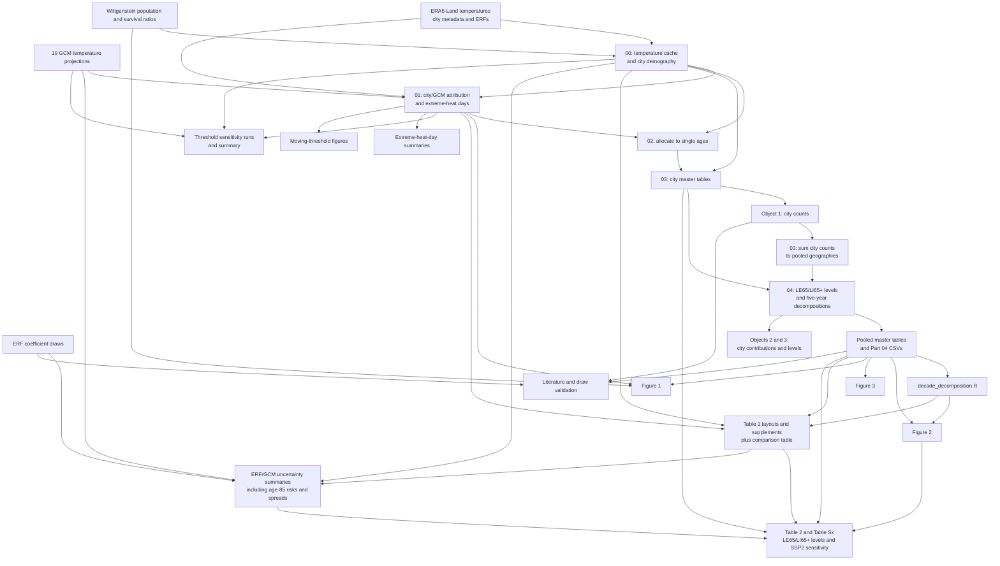

# Temperature, life expectancy and lifespan inequality

This project estimates temperature-attributable mortality in 854 European
cities and its contributions to remaining life expectancy at 65 (LE65) and
lifespan inequality at 65+ (LI65+). The five scientific pipeline parts use
Masselot et al.'s temperature-mortality projections and Lloyd et al.'s life
tables and decomposition. City counts are summed before pooled mortality rates
and life tables are calculated; city life expectancies are not averaged.

**Reproduce the paper:** obtain the [inputs and software](#inputs-and-software),
run Parts 00–04 for SSP1–3, prepare the uncertainty and sensitivity runs, then
run `analysis/run_paper_outputs.sh` with a **new** `FIGURE_ROOT`. The
[commands and run order](#how-to-reproduce) are below. The supplied SSP1 and
SSP2 results are exploratory, **not production runs**: read the
[scenario caveats](#scenario-caveats) before using any output.

## Data flow

The diagram follows the inputs and outputs actually read and written by the
scripts; arrows to an output mean that the script reads those inputs.



In the diagram, “T1 → T2” is the separate Table 1 **comparison** CSV used
for a check, not an input to the Table 2 estimates. Likewise, the uncertainty
summary is used for comparison, not to calculate the Table 2 central estimates.

## Scripts, inputs and outputs

Paths below are relative to the repository root. `<batch>` is `BATCH_ROOT`;
`<out>` is `FIGURE_ROOT`. Script headers give individual commands and file
contracts. Timings are approximate elapsed times, not guarantees; GCM count,
cores, input storage and Horiuchi steps matter.

| Script | Needs | Produces | Runtime |
|---|---|---|---|
| [pipeline/00_pkg_params.R](pipeline/00_pkg_params.R) | R packages; `data/city_results.csv` | Parameters sourced by Parts 00–04 | Seconds |
| [pipeline/00_prep_data.R](pipeline/00_prep_data.R) | ERA5, ERFs, city metadata, Wittgenstein population and survival | `<batch>/shared/prep_data.RData`; city grouped and single-age demography | Part of batch |
| [pipeline/01_attribution.R](pipeline/01_attribution.R) | Part 00, ERA5, GCM projections, ERFs | City/GCM and ENSEMBLE `01_attribution_grouped.csv`, thresholds, heat days, checks | About 30 s per city/GCM on the earlier 2-core benchmark |
| [pipeline/02_single_age.R](pipeline/02_single_age.R) | Part 00 demography and Part 01 attribution | `02_single_age_an.csv` and checks | Part of batch |
| [pipeline/03_master_table.R](pipeline/03_master_table.R) | Parts 00/02; collect mode reads city masters | `03_master_table.csv`; `collected/object1_dataset.parquet`; pooled counts | Part of batch |
| [pipeline/04_le_li_decomposition.R](pipeline/04_le_li_decomposition.R) | Part 03 city or pooled master | `04_le_li_levels.csv`, within/between-branch decompositions, checks; Objects 2 and 3 | Dominated by decomposition; depends on N |
| [analysis/paper_fig1.R](analysis/paper_fig1.R) | City ENSEMBLE Part 01, demographic inputs, SSP3 single-age demography, pooled Part 03 | Figure 1 PNG/PDF, data and checks | About 1 min for five geographies in the Nov 23 comparison |
| [analysis/decade_decomposition.R](analysis/decade_decomposition.R) | Pooled Part 03 master; called by Figure 2 and Table 1 | Decade contributions and closure checks | Included in callers |
| [analysis/paper_fig2.R](analysis/paper_fig2.R) | All three SSPs, pooled Part 03 and `04_within_branch_period_decomposition.csv`, decade helper | Figure 2 PNG/PDF, panel data, diamond and decade checks | About 2 min per geography in the Nov 23 comparison |
| [analysis/paper_fig3.R](analysis/paper_fig3.R) | Pooled Part 04 within-branch decomposition | Figure 3 and supplements, data and checks | Not separately timed |
| [analysis/paper_table1.R](analysis/paper_table1.R) | City/GCM Parts 00/01; all pooled Part 03 masters; decade helper | Table 1, S1–S4, checks and per-GCM/decade scratch | Expensive: 57 SSP/GCM cases and 35 pooled geographies |
| [analysis/paper_table_comparison.R](analysis/paper_table_comparison.R) | Pooled Parts 03/04 for all 35 geographies | Cross-scenario Table 1 comparison CSVs/PDFs | Not separately timed |
| [analysis/paper_table2.R](analysis/paper_table2.R) | Pooled Parts 03/04, Figure 2 data, Table 1 comparison and uncertainty summary | Table 2 and Sx CSVs, checks and definitions | Seconds after inputs exist |
| [analysis/extreme_temperature_thresholds.R](analysis/extreme_temperature_thresholds.R) | Part 01 moving-threshold checks, every city/GCM/SSP | Threshold plots and CSVs | Reads 48,678 check files |
| [analysis/run_erf_uncertainty.sh](analysis/run_erf_uncertainty.sh), [analysis/erf_uncertainty_pilot.R](analysis/erf_uncertainty_pilot.R), [analysis/summarize_erf_uncertainty.R](analysis/summarize_erf_uncertainty.R) | ERF draws, temperatures, Part 00 demography; Table 1 for summary | SSP2/SSP3 GCM × draw metrics and summaries | Expensive: 19 GCMs × 500 draws per SSP; not timed here |
| [analysis/run_threshold_sensitivity.sh](analysis/run_threshold_sensitivity.sh), [analysis/summarize_threshold_sensitivity.R](analysis/summarize_threshold_sensitivity.R) | Part 00 demography, temperatures; canonical and alternative Part 01 results | Isolated threshold runs and comparison tables | Each run is 48,678 city/GCM/SSP jobs |
| [analysis/summarize_extreme_heat_days.R](analysis/summarize_extreme_heat_days.R) | Part 01 heat-day CSVs and GCM manifest | City/geography CSVs and warning-day plots | Reads 48,678 heat-day files |
| [analysis/central_missing_results.R](analysis/central_missing_results.R) | Pooled Parts 03/04 and `table1_full.csv` | Central supplementary results and checks | Not separately timed |
| [analysis/literature_validation.R](analysis/literature_validation.R), [analysis/validate_erf_draws.R](analysis/validate_erf_draws.R) | Completed pipeline and external reference data, or Madrid draw pilot | Validation comparisons and checks | Depends on inputs; not separately timed |
| [analysis/run_paper_outputs.sh](analysis/run_paper_outputs.sh) | All completed paper inputs above | Paper figures, tables, summaries, checks and logs under a new `<out>` | Sum of output steps, dominated by Table 1 and file reads |

`analysis/output_names.R` and `analysis/paper_helpers.R` are sourced helpers,
not independent stages. The output driver calls analysis/run_paper_figures.sh for Figures 1-3, Table 1 and threshold figures, then produces uncertainty summaries, Table 2, central supplements, threshold sensitivity and heat-day summaries.
Literature and draw validation are separate because they require external reference inputs and a Madrid pilot.

`EXPLORATORY_SCENARIO_STYLE=1` when running Figure 2 or Figure 3 to render SSP1
and SSP2 bars at 48% opacity and add the exploratory caveat. The default is
`0`, so ordinary figure rendering is unchanged.

For SSP3 Europe, Table 2's central all-temperature warming reduction is 4.3%
(pooled ENSEMBLE, central period-mean rate), while the combined 19-GCM ×
500-draw experiment median is 3.9%. For heat alone the corresponding summaries
are 7.4% and 7.0%. They are different estimands, not contradictory rounding.

## Inputs and software

Install R and the R packages used by the pipeline and presentation scripts:

```r
install.packages(c("data.table", "arrow", "dplyr", "dlnm", "ungroup",
                   "DemoDecomp", "ggplot2", "patchwork", "ggrepel",
                   "flextable", "officer", "scales"))
```

Table 1 PDF export also requires LibreOffice (`soffice`) and Cairo graphics.
The Eurostat validation helper requires Python with `requests`. The Nov 23
comparison used R 4.5.0, data.table 1.18.6.1, arrow 25.0.1, DemoDecomp 1.14.1,
ggplot2 4.0.3 and patchwork 1.3.2.

`data/city_results.csv`, `data/coefs.csv` and `data/vcov.csv` are tracked.
Obtain the large, ignored inputs from the Masselot et al. 2025
[data archive](https://doi.org/10.5281/zenodo.14004322): place
`era5series.gz.parquet`, `tmeanproj.gz.parquet`, `wittgenstein_pop.csv`, and
`wittgenstein_assr.csv` under `data/`. The `coef_simu.csv` coefficient draws
are also needed for uncertainty; the 2023
[archive](https://doi.org/10.5281/zenodo.10288665) is the original source.
The uncertainty code expects a parquet copy at the exact ignored path below:

```bash
mkdir -p references/2025-masselot-data
Rscript -e 'arrow::write_parquet(data.table::fread("data/coef_simu.csv"), "references/2025-masselot-data/coef_simu.gz.parquet", compression="gzip")'
```

The local CSV and parquet copies were checked to have the same 4,270,000 rows
and values. Keep all external data, `references/`, results and logs out of git.

## How to reproduce

Run commands from the repository root. Select **new** paths instead of
overwriting an existing result pack. A complete SSP over 854 cities was
historically estimated at about 140 CPU-hours and 15 GB; 4–5 hours on 32 cores
was an earlier estimate, not a guarantee. A full rebuild plus sensitivity and
uncertainty runs is substantially more expensive.

### 1. Scientific pipeline

The following runs use one isolated batch root so that the collected objects
and pooled geographies contain all three SSPs. The SSP1 and SSP2 switches are
sensitivities, not production fixes.

```bash
export BATCH_ROOT_OVERRIDE=results/europe/sensitivities/paper_run_new
BUILD_PREP_CACHE=1 N_HORIUCHI=400 SKIP_MX_PLAUSIBILITY_CHECK=1 \
  ASSR_ONE_REPLACEMENT=0.9995 ./run_pipeline.sh 1 all 32
BUILD_PREP_CACHE=1 N_HORIUCHI=400 SKIP_MX_PLAUSIBILITY_CHECK=1 \
  ./run_pipeline.sh 2 all 32
BUILD_PREP_CACHE=1 N_HORIUCHI=400 ./run_pipeline.sh 3 all 32
export BATCH_ROOT="$BATCH_ROOT_OVERRIDE"
```

The runner executes Parts 00–04, the 19-GCM ensemble, collection, and pooled
Europe, four regions and 30 countries. It records input settings and checks.
`BUILD_PREP_CACHE=1` permits creation of a missing fingerprinted temperature
cache. Existing runs are resumable only when their manifest, cache and exact
pipeline source fingerprints match; use a new root rather than replacing an
old one. Header edits also change source fingerprints. The original SSP1
heatsplit manifest records a dirty worktree, so its commit alone does not fully
identify the source used for that historical run.

### 2. Uncertainty, sensitivity and heat-day inputs

These are separate, computationally intensive input runs. They reuse Part 00
demography and never write into the completed batch:

```bash
export THRESHOLD_ROOT=results/paper_threshold_new
CANONICAL_ROOT="$BATCH_ROOT" analysis/run_threshold_sensitivity.sh trailing30_p975 0.975 30 4 0.025
CANONICAL_ROOT="$BATCH_ROOT" analysis/run_threshold_sensitivity.sh trailing15_p95_p05 0.95 15 4 0.05

export EXTREME_HEAT_DAYS_ROOT=results/paper_heat_days_new/canonical_p975_p025
CANONICAL_ROOT="$BATCH_ROOT" THRESHOLD_ROOT=results/paper_heat_days_new \
  EXTREME_HEAT_DAYS_ONLY=1 \
  analysis/run_threshold_sensitivity.sh canonical_p975_p025 0.975 15 4 0.025

export UNCERTAINTY_ROOT=results/paper_uncertainty_new
analysis/run_erf_uncertainty.sh 2 4
analysis/run_erf_uncertainty.sh 3 4
```

The uncertainty runner supports SSP2 and SSP3; it uses the same 500 ERF draw
IDs across cities and pools counts before life tables. The heat-day run is a
temperature-threshold proxy, not a record of official warnings.

### 3. Paper outputs

```bash
export FIGURE_ROOT=results/paper_output_new
export GEO_SCOPE=main                 # Europe and four regions; all adds countries
analysis/run_paper_outputs.sh --check-inputs
analysis/run_paper_outputs.sh
```

The preflight checks all required files, the GCM manifests and R packages before creating the output directory.
The output driver accepts TABLE1_CORES, THRESHOLD_SUMMARY_CORES and EXTREME_HEAT_DAYS_SUMMARY_CORES to control parallelism; each defaults to 4.
ATTRIBUTION_ROOT can point Figure 1 to an alternative Part 01 root; it defaults to BATCH_ROOT. The driver refuses an existing output root and refuses output inside an input root. A failed stage stops with a log path; choose a fresh output root for another run.
Expect Figure PNGs under <out>/figures/, PDFs under <out>/figures_pdf/, figure data and Table 2 under <out>/data/, Table 1 under <out>/table1/, and supplementary results, uncertainty, scratch and logs in named subdirectories.
Table 2 checks read the Table 1 comparison and uncertainty summary just produced in this root.

The literature validation also needs Masselot's `eu_period.parquet` and
`region_period.parquet`, Lloyd's `outdata` reference files listed in the script
header, and an independently retrieved Eurostat CSV. Set the two reference
roots to the locations on your system:

```bash
export VALIDATION_ROOT=results/paper_validation_new
python analysis/fetch_eurostat_le65.py "$VALIDATION_ROOT/eurostat_le65.csv"
MASSELOT_RESULTS_ROOT=/path/to/masselot/results_parquet \
  LLOYD_ROOT=/path/to/Reciprocal-Lloyd \
  Rscript analysis/literature_validation.R
```

For the Madrid draw validation, first generate an isolated 500-draw pilot,
then compare it with the same batch's Madrid central output:

```bash
SSP=3 GCM=GFDL_ESM4 CITY_IDS=ES001C DRAW_IDS=1-500 \
  UNCERTAINTY_ROOT="$VALIDATION_ROOT/madrid_draws" \
  Rscript analysis/erf_uncertainty_pilot.R
TIMING500_ROOT="$VALIDATION_ROOT/madrid_draws/part01/ssp3/GFDL_ESM4" \
  UNCERTAINTY_ROOT="$VALIDATION_ROOT/draw_checks" \
  Rscript analysis/validate_erf_draws.R
```

Exploratory diagnostics not used by the paper driver are in
[`analysis/diagnostics/`](analysis/diagnostics/).

## Scenario caveats

- **SSP1-2.6:** survival ratios stored as exactly 1 are replaced by 0.9995 in
  the exploratory batch. Its manifest also records
  `SKIP_MX_PLAUSIBILITY_CHECK=1`; the replacement is not a production fix.
  The checked batch records 26,183 replaced source cells across 771 cities;
  the guard-bypass warning is present for all 854 cities, and 562 cities also
  have a within-age-group plausibility warning.
- **SSP2-4.5:** the exploratory batch includes 12 Swiss cities with the
  mortality-shape check bypassed. Inclusion does not validate their
  reconstruction. Production excludes those cities, and no complete pooled
  production SSP2 geography is available. The checked batch has warnings for
  those 12 cities only (maximum within-group decline 11.09%); the bypass flag
  is recorded for all 854 cities.
- The 5% within-age-group mortality-shape guard is an internal safeguard, not
  an established demographic standard. The switches and warnings are recorded
  in Part 00 checks and manifests. The SSP1/SSP2 runs above are **not
  production runs**.
- Central estimates use the mean attributable deaths across 19 GCMs. ERF-draw
  uncertainty and GCM spread have different interpretations; see the generated
  uncertainty summaries. Heat-only Table Sx erosion uses the heat-deleted
  schedule in `erf_uncertainty_pilot.R`, not the earlier Table 1 comparison
  heat-contribution ratio.

## Method and sources

The temperature basis and MMT use the full ERA5-Land 1990–2019 series.
Static extreme thresholds use 2000–2014; the moving P97.5 adds the calibrated
GCM change over the preceding 15 years and is clamped at the static threshold.
The without-climate-change series follows Masselot's `demo` recalibration.
The study-specific heat split has moderate, normal-extreme and extreme ranges.
Part 04 uses single ages 65–100+ and Horiuchi decompositions; the paper defaults
to consecutive five-year-period means and N = 400. See the five script headers
for the detailed contracts and departures from the reference implementations.

- Masselot P et al. Excess mortality attributed to heat and cold. *Lancet Planet
  Health* (2023), doi:10.1016/S2542-5196(23)00023-2.
- Masselot P et al. Future heat- and cold-related mortality in 854 European
  cities. *Nature Medicine* (2025), doi:10.1038/s41591-024-03452-2.
- Lloyd SJ et al. Temperature-related mortality and longevity. *Environment
  International* (2024), doi:10.1016/j.envint.2024.109050.
- Horiuchi S, Wilmoth JR, Pletcher SD. A decomposition method based on a model
  of continuous change. *Demography* (2008).
- Rizzi S, Gampe J, Eilers PHC. Efficient estimation of smooth distributions
  from coarsely grouped data. *American Journal of Epidemiology* (2015).
